# Станция SONIKS с монитором — установка шаг за шагом

Версия монитора 0.1alfa. Автор: YL3GBC Arnis Armans.

Эта инструкция — для тех, кто раньше не работал с Linux. Делайте всё
по порядку. После каждого шага есть раздел **«Что вы увидите»**.
**Переходите дальше, только когда у вас на экране то же самое.**

Ничего собирать и компилировать не нужно: все программы скачиваются
готовыми.

Код клиента SONIKS не меняется. Монитор только читает данные станции.

---

## Что нужно до начала

1. **Станция зарегистрирована на портале sonik.space.** У вас есть
   номер станции (например `123`) и API-ключ (длинная строка из букв
   и цифр). Оба есть на портале, на странице вашей станции.
2. **На компьютере станции установлен Docker и подготовлен
   SDR-приёмник** — по руководству SONIKS, шаги 3 и 4. Если это ещё
   не сделано, сначала сделайте это.
3. **Компьютер подключён к интернету.**
4. **Компьютер на amd64 (x86_64)** — обычный ПК или ноутбук. Версия
   монитора для Raspberry Pi (arm64) пока не готова.

---

## Шаг 0. Откройте терминал

**Что такое терминал:** чёрное окно, в котором пишут команды. Мышь
там не работает, всё делается клавиатурой.


### Вариант А. Вы сидите прямо за компьютером станции (у него есть экран)

1. Нажмите вместе три клавиши: `Ctrl` + `Alt` + `T`.
2. Если ничего не открылось — найдите на верхней или нижней панели
   значок с чёрным квадратом. Он называется «Terminal» или
   «Терминал». Нажмите на него.

**Что вы увидите:** окно со строкой примерно такого вида:

```
ivan@station:~$
```

Это **командная строка**. Команды пишут после знака `$`.

### Вариант Б. Станция — Raspberry Pi или компьютер без экрана, а вы сидите за Windows

**Важно:** компьютер с Windows и компьютер станции должны быть
**в одной домашней сети** — подключены к одному и тому же роутеру
(кабелем или к тому же Wi-Fi). Иначе подключиться не получится.

1. Нажмите на клавиатуре клавишу с логотипом Windows.
2. Напишите `cmd` и нажмите `Enter`. Откроется чёрное окно.
3. Напишите команду, подставив свои данные:

```
ssh пользователь@адрес-станции
```

   - `пользователь` — имя пользователя на компьютере станции
     (на Raspberry Pi часто `pi`);
   - `адрес-станции` — адрес компьютера станции в домашней сети,
     например `192.168.1.50`. Его обычно видно в настройках
     домашнего роутера.

   Пример: `ssh pi@192.168.1.50`

4. Нажмите `Enter`.
5. В первый раз появится вопрос, который заканчивается на
   `(yes/no)?`. Напишите `yes` и нажмите `Enter`.
6. Теперь спросят пароль (`password:`). Напишите пароль компьютера
   станции и нажмите `Enter`.

   **Важно:** пока вы пишете пароль, на экране **ничего не
   появляется**, даже звёздочки. Так и должно быть — пишите спокойно.


**Что вы увидите:** строка изменится примерно так:

```
pi@raspberrypi:~ $
```

Теперь вы на компьютере станции. Все следующие команды пишите
в этом окне.

**Если видите другое:**

- `Connection refused` или `timed out` — неверный адрес, компьютер
  станции выключен или он в другой сети. Проверьте адрес и сеть.
- `Permission denied` — неверное имя пользователя или пароль.
  Попробуйте ещё раз.

### Как вставить команду

Команды из этой инструкции лучше **копировать**, а не перепечатывать
— так не будет ошибок.

- **В терминале Linux:** вставка — `Ctrl` + `Shift` + `V`. Обычное
  `Ctrl` + `V` там не работает.
- **В чёрном окне Windows:** вставка — **правой кнопкой мыши**.

### Главное правило

Вставили **одну** команду → нажали `Enter` → **ждите**, пока снова
не появится командная строка со знаком `$` в конце. Только после
этого вставляйте следующую.

---

## Шаг 1. Проверьте Docker Compose

```
docker compose version
```

**Что делает:** показывает версию Docker Compose.

**Зачем:** монитору нужен Docker Compose **v2.23 или новее**.

**Что вы увидите:**

```
Docker Compose version v2.29.1
```

Число после `v2.` должно быть **23 или больше**. Версии `v3` и
выше тоже подходят. Если меньше — обновите Docker по руководству SONIKS
(раздел «Если Docker уже был установлен»).

---

## Шаг 2. Создайте папку для станции

```
mkdir ~/station
```

**Что делает:** создаёт новую папку с названием `station` в вашей
домашней папке. `mkdir` значит «создать папку», а `~` — «моя
домашняя папка».

**Зачем:** все файлы станции будут лежать в одном месте. Docker
ищет файлы именно в той папке, где вы находитесь, поэтому они
должны быть вместе.

**Что вы увидите:** ничего. Сразу снова появится командная строка.
Это значит, что всё получилось.

**Если видите другое:**

- `File exists` — такая папка уже есть, например от прошлой
  попытки. Ничего страшного, переходите к следующему шагу.

---

## Шаг 3. Зайдите в папку

```
cd ~/station
```

**Что делает:** переключает терминал в папку `station`. `cd` значит
«зайти в папку».

**Зачем:** всё, что вы скачаете дальше, попадёт именно сюда.
И станцию всегда запускают из этой папки.

**Что вы увидите:** в командной строке появится `station`:

```
ivan@station:~/station$
```

**Запомните:** если вы закрыли терминал и открыли снова — сначала
всегда пишите `cd ~/station`.

---

## Шаг 4. Скачайте файл настроек

```
wget https://raw.githubusercontent.com/yl3gbc/yl3gbc-radio-addons/main/station/.env
```

**Что делает:** скачивает из интернета файл `.env` и кладёт его
в папку `station`. `wget` значит «скачать».

**Зачем:** в этом файле хранятся ваши данные: номер станции,
API-ключ и пароли. Без них станция не знает, кто она.

**Обратите внимание:** точка в начале имени (`.env`) значит, что
файл «скрытый». В обычном списке файлов его не видно — это нормально.

**Что вы увидите:** несколько строк о скачивании, а в конце строка
со словом `saved`:

```
'.env' saved
```


**Если видите другое:**

- `404 Not Found` — адрес скопирован не полностью. Скопируйте
  команду ещё раз, всю строку целиком.
- `Could not resolve host` — нет интернета. Проверьте подключение.

---

## Шаг 5. Впишите свои данные в файл `.env`

### 5.1. Сначала получите токен для графиков

```
openssl rand -hex 32
```

**Что делает:** придумывает длинную случайную строку.

**Зачем:** это «токен» — пароль, по которому программы графиков
узнают друг друга. Придумать такой вручную трудно, поэтому его
делает компьютер.

**Что вы увидите:** одну длинную строку из цифр и букв, например:

```
9f2c4e7a1b8d3f6e0c5a2d9b7e4f1a8c3d6b0e5f2a9c7d4e1b8f3a6c0d5e2b9f
```

**Выделите её мышью и скопируйте** (в терминале Linux — `Ctrl` +
`Shift` + `C`, в окне Windows — выделить и нажать правую кнопку
мыши). Она понадобится через минуту.

### 5.2. Откройте файл

```
nano .env
```

**Что делает:** открывает файл `.env` в простом текстовом
редакторе `nano`.

**Зачем:** в шаблоне ваших данных ещё нет — их нужно вписать самому.

**Что вы увидите:** в терминале появится текст файла. Внизу —
строки с подсказками, например `^O Write Out` и `^X Exit`. Знак `^`
означает клавишу `Ctrl`.


### Как работать в `nano`

- **Двигаться** можно только **стрелками** на клавиатуре
  (↑ ↓ ← →). Мышь здесь не работает.
- **Стирать** — клавишей `Backspace` (стирает знак слева от
  курсора).
- **Писать** — просто на клавиатуре, текст появляется там, где
  стоит курсор.
- **Вставить** скопированное — `Ctrl` + `Shift` + `V` (Linux) или
  правой кнопкой мыши (Windows).

### Что заполнить

Над каждой строкой, которую нужно заполнить, стоит строка
**`# ↓ ЗАПОЛНИТЕ`**. Стрелками дойдите до строки под ней, нажмите
клавишу `End` (курсор встанет в конец строки, сразу после знака
`=`) и впишите своё значение.

**Правила для всех строк:**

- пишите сразу после `=`, **без пробела**;
- **никаких кавычек**;
- знак `=` и текст перед ним **не трогайте**.

| Строка | Что вписать | Пример |
|---|---|---|
| `STATION__TOKEN=` | API-ключ с портала, весь до последнего знака | `STATION__TOKEN=a1b2c3d4e5f6…` |
| `STATION__ID=` | номер станции с портала, только цифры | `STATION__ID=123` |
| `INFLUX_PASSWORD=` | придумайте пароль, не короче 8 знаков | `INFLUX_PASSWORD=Solnce2026x` |
| `INFLUX_TOKEN=` | строку из шага 5.1 | `INFLUX_TOKEN=9f2c4e7a1b8d…` |
| `GRAFANA_PASSWORD=` | придумайте пароль для страницы графиков | `GRAFANA_PASSWORD=Luna2026y` |

Первые две строки — в начале файла. Остальные три — в самом конце
файла, в части «SONIKS MONITOR». Быстро попасть в конец файла:
`Alt` + `/`.

**Запишите пароли** себе в надёжное место. `GRAFANA_PASSWORD`
понадобится, чтобы войти в графики.

### Как сохранить и выйти

1. Нажмите `Ctrl` + `O` (буква O, не ноль). Внизу появится
   `File Name to Write: .env`.
2. Нажмите `Enter`. Файл сохранён.
3. Нажмите `Ctrl` + `X`. Редактор закроется, и вы снова в командной
   строке.

**Если случайно нажали `Ctrl` + `X` без сохранения:** внизу спросят
`Save modified buffer?`. Нажмите `Y`, потом `Enter`.

### 5.3. Проверьте

```
grep -A1 '^# ↓' .env
```

**Что делает:** показывает каждую строку «ЗАПОЛНИТЕ» и строку под ней.

**Что вы увидите:** пять пар строк, и в каждой второй строке после
`=` — ваше значение:

```
# ↓ ЗАПОЛНИТЕ: API-ключ станции с портала sonik.space
STATION__TOKEN=a1b2c3d4e5f6...
# ↓ ЗАПОЛНИТЕ: номер станции с портала, только цифры
STATION__ID=123
--
# ↓ ЗАПОЛНИТЕ: пароль базы графиков, не короче 8 символов
INFLUX_PASSWORD=Solnce2026x
--
# ↓ ЗАПОЛНИТЕ: токен базы графиков
INFLUX_TOKEN=9f2c4e7a1b8d...
--
# ↓ ЗАПОЛНИТЕ: пароль графиков Grafana (имя: admin)
GRAFANA_PASSWORD=Luna2026y
```

Если где-то после `=` пусто — откройте `nano .env` ещё раз и
допишите.

---

## Шаг 6. Скачайте описание станции SONIKS

```
wget https://gitlab.com/space-education-development/soniks/client/soniks-client/-/raw/3.0.0/client/docker-compose.yml
```

**Что делает:** скачивает файл `docker-compose.yml`.

**Зачем:** этот файл говорит Docker, как запустить клиент SONIKS —
программу, которая принимает спутники и отправляет данные на портал.
Это официальный файл SONIKS, его **не меняйте**.

**Что вы увидите:** как в шаге 4, в конце `'docker-compose.yml' saved`.

---

## Шаг 7. Скачайте описание монитора

```
wget https://raw.githubusercontent.com/yl3gbc/yl3gbc-radio-addons/main/station/docker-compose.override.yml
```

**Что делает:** скачивает файл `docker-compose.override.yml`.

**Зачем:** этот файл добавляет монитор (страницу станции в браузере)
и графики. Docker находит этот файл и добавляет его **сам**, если он
лежит в той же папке, что и `docker-compose.yml`. Больше ничего
делать не нужно.

**Что вы увидите:** в конце `'docker-compose.override.yml' saved`.

### Проверьте, что все три файла на месте

```
ls -a
```

**Что делает:** показывает все файлы папки, в том числе скрытые.

**Что вы увидите:** в списке должны быть эти три:

```
.  ..  .env  docker-compose.override.yml  docker-compose.yml
```

Если какого-то нет — повторите нужный шаг.


---

## Шаг 8. Скачайте программы

```
docker compose pull
```

**Что делает:** скачивает из интернета все программы станции:

- клиент SONIKS (приём спутников);
- агент обновлений SONIKS;
- rigctld (управление приёмником, из файла SONIKS);
- монитор (страница станции);
- четыре программы для графиков: mosquitto, influxdb, telegraf,
  grafana.

**Зачем:** программы готовые, ничего собирать не нужно. Их нужно
только скачать.

**Что вы увидите:** много строк о скачивании. В первый раз это может
занять **от нескольких минут до получаса** — зависит от скорости
интернета. Ждите, пока снова не появится командная строка. В конце
у каждой программы должно быть слово `Pulled`.


**Если видите другое:**

- `permission denied` и `docker.sock` — после установки Docker вы не
  перезашли в систему. Закройте терминал, откройте заново (или
  перезагрузите компьютер), напишите `cd ~/station` и повторите
  этот шаг.
- `no configuration file provided` — вы не в папке станции. Напишите
  `cd ~/station` и повторите.
- Ошибка `502` или скачивание остановилось — сервер перегружен.
  Просто повторите ту же команду. Уже скачанное заново не качается.

---

## Шаг 9. Запустите станцию

```
docker compose up -d
```

**Что делает:** запускает все программы.

**Зачем `-d`:** значит «в фоне». Станция работает и тогда, когда
терминал закрыт. После перезагрузки компьютера она запускается сама.

**Что вы увидите:** список программ, у каждой — `Started` или
`Running`.


### Проверьте

```
docker compose ps
```

**Что делает:** показывает, какие программы работают.

**Что вы увидите:** таблицу, где в столбце `STATUS` у каждой строки
стоит `Up`. У клиента через минуту-две появится ещё `(healthy)`.


**Если видите другое:**

- `Restarting` или `Exited` — ошибка в какой-то строке `.env`.
  Откройте `nano .env`, проверьте строки по правилам шага 5,
  сохраните и снова выполните `docker compose up -d`.

---

## Шаг 10. Откройте монитор и графики

Сначала узнайте адрес компьютера станции:

```
hostname -I
```

**Что вы увидите:** одно или несколько чисел, например
`192.168.1.50`. Нужно первое.

**Важно, если станция работает на Raspberry Pi или другом отдельном
компьютере:** этот компьютер и компьютер, с которого вы открываете
монитор, должны быть **в одной домашней сети** — подключены
к одному и тому же роутеру (кабелем или к тому же Wi-Fi).

- **Правильно:** Raspberry Pi подключён к домашнему роутеру кабелем,
  а ноутбук — к домашнему Wi-Fi. Оба через один роутер.
- **Неправильно:** ноутбук подключён к мобильному интернету
  телефона, к гостевому Wi-Fi или находится в другом доме. Тогда
  монитор **не откроется**, даже если адрес верный.

**Как проверить:** адрес станции (например `192.168.1.50`) и адрес
вашего компьютера обычно начинаются одинаково — с первых трёх чисел
(`192.168.1.`). Если начало разное (например `192.168.0.` и
`192.168.1.`), устройства, скорее всего, в разных сетях.

Теперь откройте браузер (Chrome, Firefox, Edge) и в строке адреса
напишите (вместо `192.168.1.50` — свой адрес):

- **Монитор:** `http://192.168.1.50:8090`
- **Графики:** `http://192.168.1.50:3000`

Адрес начинается с **`http://`**, а не с `https://`.

В **графиках** спросят вход: имя `admin`, пароль — тот, что вы
вписали в `.env` в строку `GRAFANA_PASSWORD`.

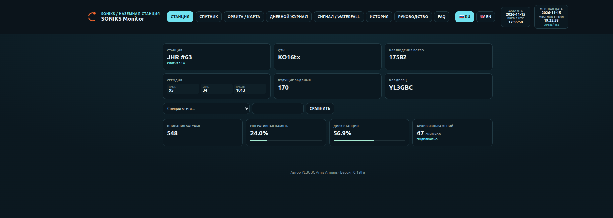


**Если страница не открывается:**

- Подождите 1–2 минуты после шага 9: программам нужно время, чтобы
  запуститься.
- Проверьте, что в адресе `http://`, а не `https://`.
- Проверьте номер после двоеточия (`8090` или `3000`).
- Проверьте, что оба компьютера в одной сети (см. выше).

---

## Как обновить до новой версии

Когда выйдет новая версия, откройте терминал и по очереди:

```
cd ~/station
```

```
docker compose pull
```

```
docker compose up -d
```

Ваши данные и настройки сохраняются.

---

## Как выглядит монитор

Монитор очень похож на страницу станции на портале sonik.space:
многое, что есть там, видно прямо на станции. Вверху — меню, справа —
дата и время UTC и местное время. Язык — кнопки RU / EN.

### Станция

Номер станции и версия клиента, QTH, наблюдения всего и за сегодня,
будущие задания, владелец. Ниже — описания satyaml, оперативная
память, диск станции и архив изображений (нажатие на карточку
открывает архив).


**«Сравнить»** — выберите станцию из списка или впишите её номер
и нажмите «Сравнить»: рядом появятся её данные с портала.

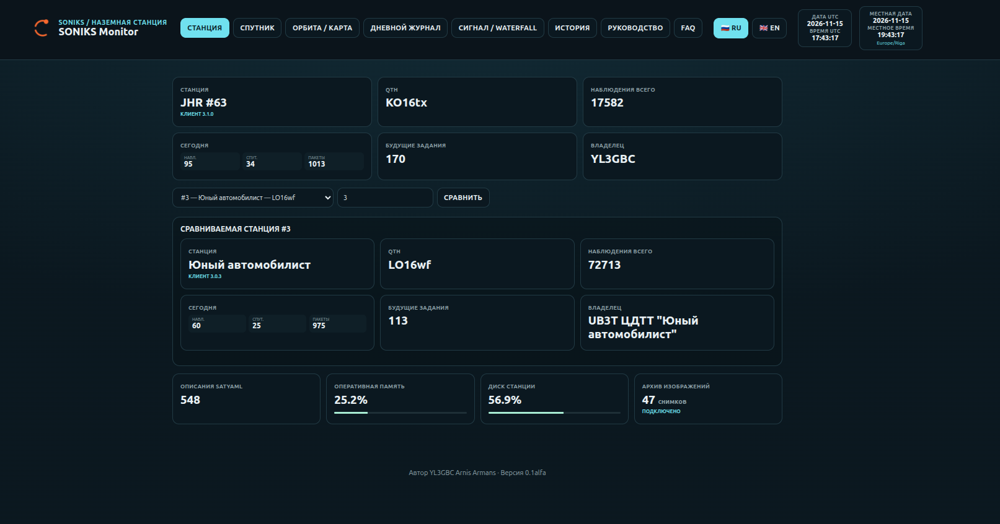

### Спутник

Выбор спутника: сводка, порог SNR по режиму спутника, лучший приём,
наблюдения по дням и последние наблюдения.

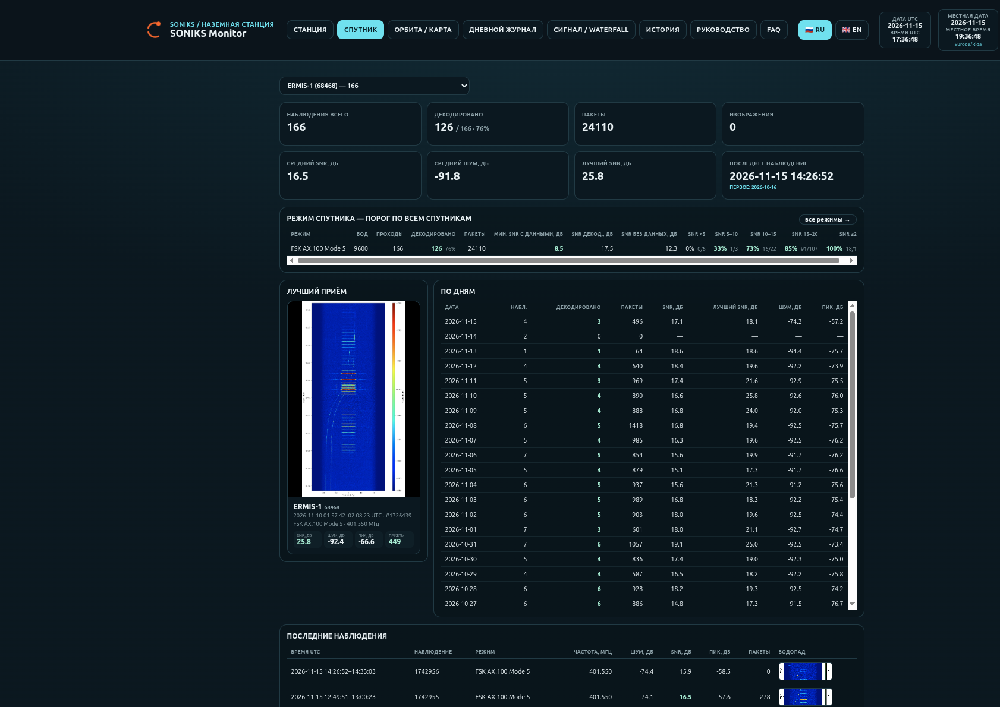

### Орбита / карта

Положение спутников на карте, пролёт над станцией (полярная
диаграмма) и ближайшие пролёты за 24 часа: максимальный угол
и азимут AOS → LOS.

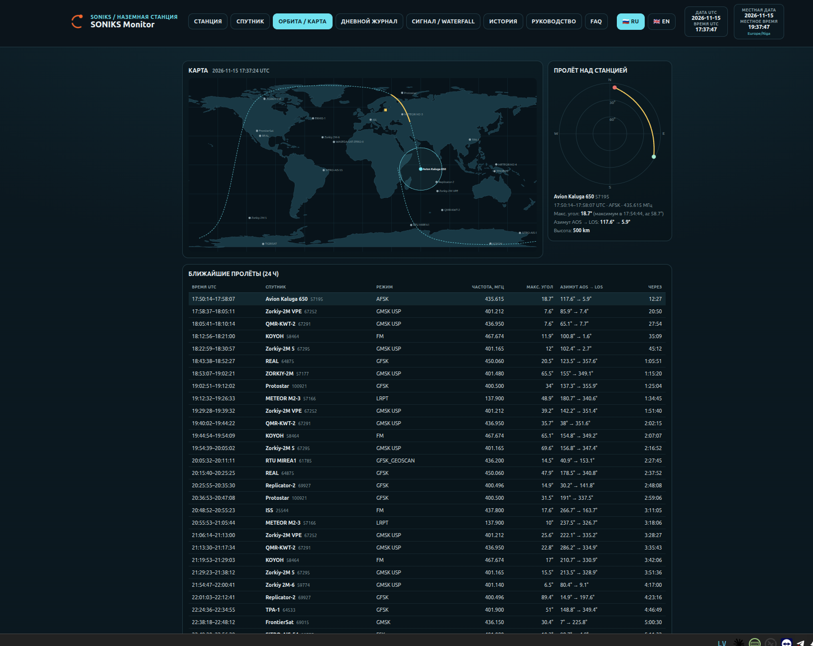

### Дневной журнал

Выбор дня. Итоги дня, средние по спутникам (шум, SNR, пик) и список
наблюдений с водопадами.

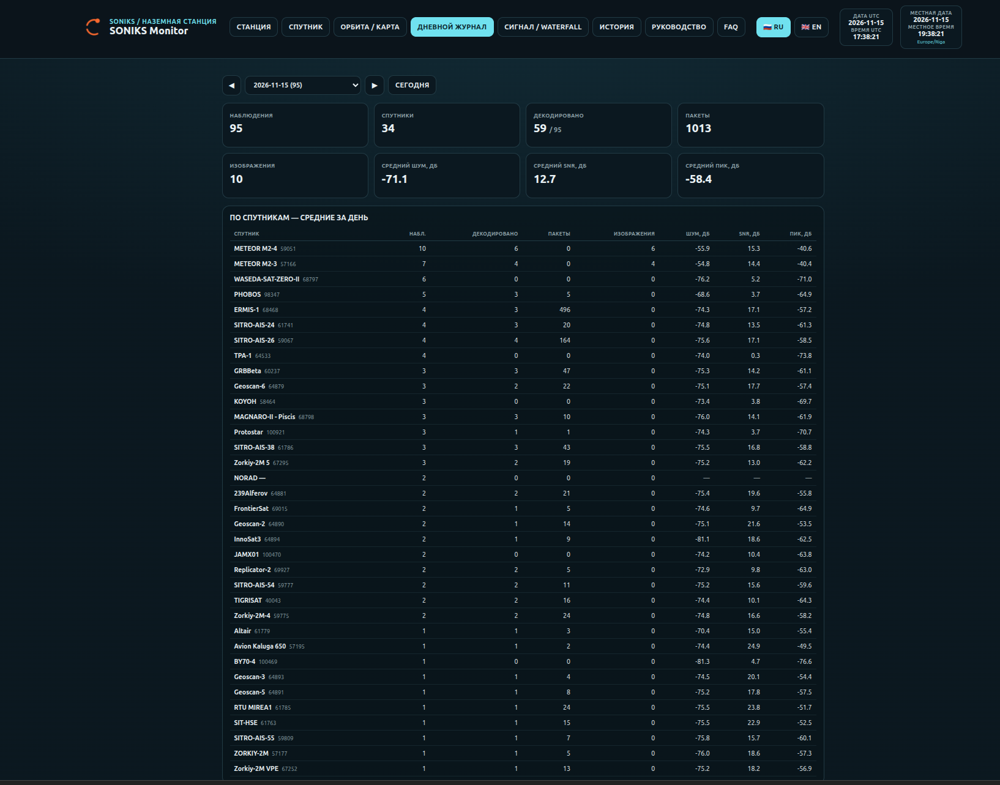

### Сигнал / waterfall

Таблица по режимам (модуляция и скорость) за последние 90 дней:
с какого SNR приём декодируется. Ниже — водопады за выбранный день,
фильтр по спутнику и «только декодированные».

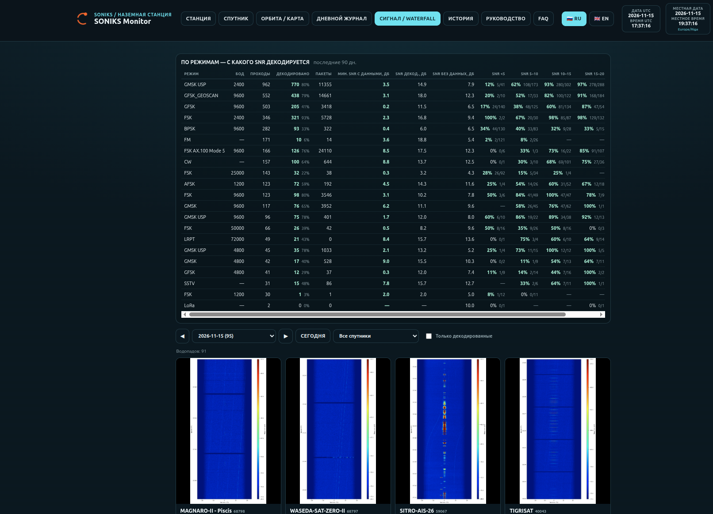

### История

Графики за 7, 30 или 90 дней: наблюдения, пакеты, спутники, средний
SNR и шум. Внизу — таблица по дням.

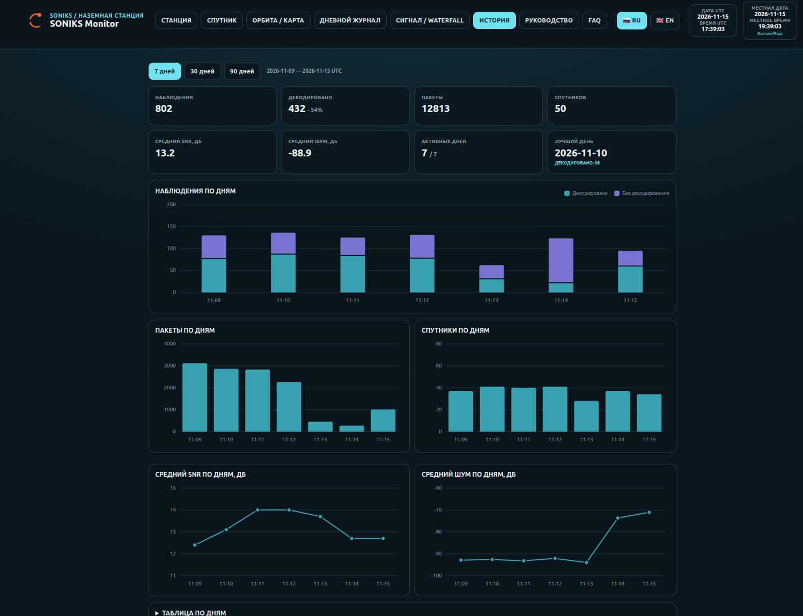

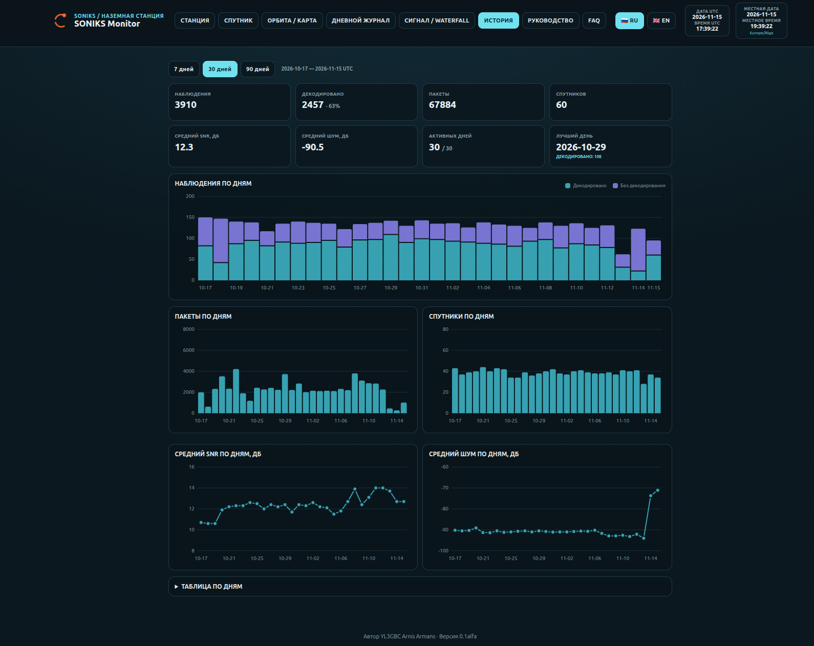

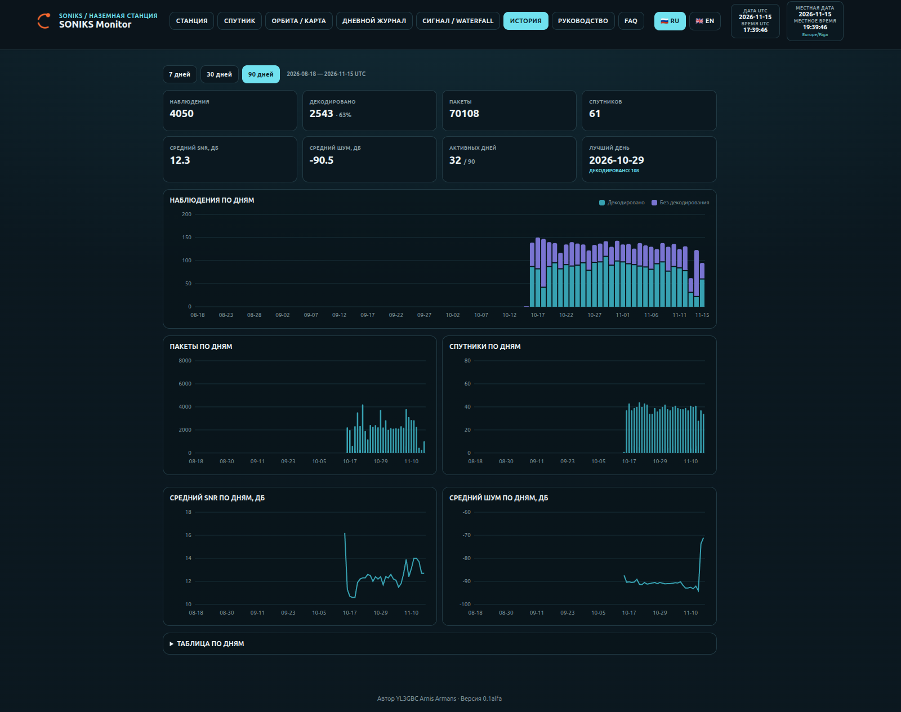

### Руководство и FAQ

Описание всех страниц монитора и ответы на частые вопросы — прямо
в мониторе, на русском и английском.

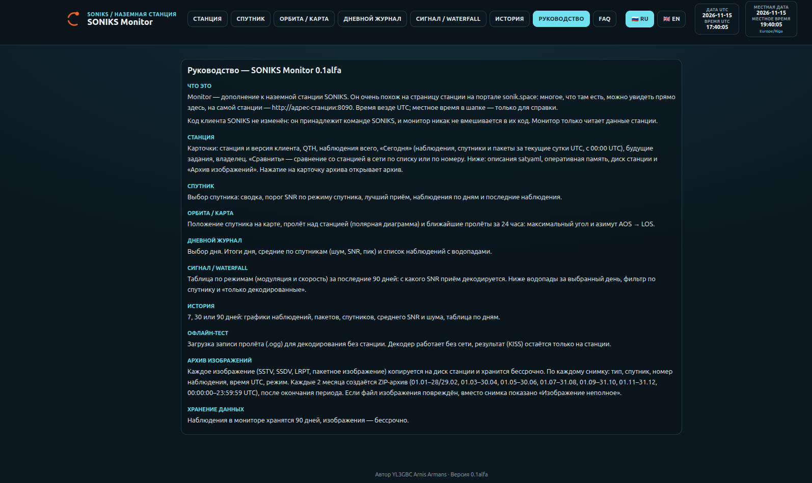

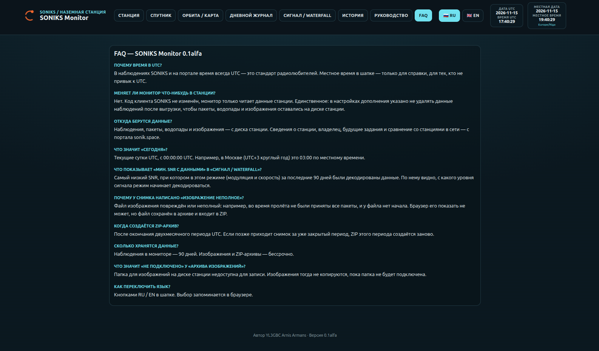

---

## Какие программы работают на станции

| Программа | Что делает | Откуда |
|---|---|---|
| `sonikspace/soniks-client` | клиент SONIKS, приём спутников | файл SONIKS |
| `sonikspace/soniks-agent` | агент обновлений SONIKS | файл SONIKS |
| `librespace/hamlib` (rigctld) | управление приёмником | файл SONIKS |
| `yl3gbc/soniks-monitor` | монитор, порт 8090 | этот файл |
| `eclipse-mosquitto:2` | локальный MQTT-брокер | этот файл |
| `influxdb:2` | база данных для графиков | этот файл |
| `telegraf:latest` | переносит данные из MQTT в InfluxDB | этот файл |
| `grafana/grafana-oss` | графики, порт 3000 | этот файл |

## Где лежат данные

В папке `~/station/data/`:

- `monitor/` — база монитора, наблюдения хранятся 90 дней;
- `images/` — архив изображений, копии хранятся бессрочно,
  ZIP по 2 месяца;
- `influxdb/` — данные графиков, 90 дней.

Завершённые наблюдения клиента лежат в томе клиента SONIKS. Монитор
читает их оттуда и удаляет те, что старше 90 дней.
